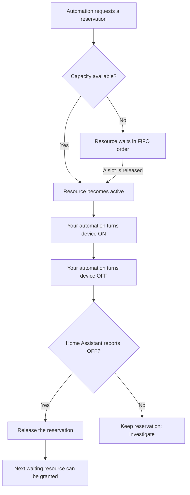

[](https://www.home-assistant.io/)
[](https://hacs.xyz/)
[](https://github.com/HamzaKarfa/Resource-Queue-Manager/actions/workflows/validate.yml)
[](https://github.com/HamzaKarfa/Resource-Queue-Manager/actions/workflows/home-assistant-tests.yml)
[](LICENSE)


# Resource Queue Manager (FIFO)

[](https://my.home-assistant.io/redirect/marketplace_repository/?owner=HamzaKarfa&repository=Resource-Queue-Manager&category=integration)


**Resource Queue Manager (FIFO)** is a Home Assistant custom integration that coordinates a configurable number of **simultaneous resource reservations** using a first-in, first-out (FIFO) queue.

The FIFO engine is generic: a request is assigned a reservation immediately when capacity permits, or placed in a waiting queue. The current Home Assistant adapter supervises `light` and `switch` entities. **Your automations remain responsible for switching devices ON and OFF**; this integration only grants and tracks reservations.

> **Experimental software scheduler, not a safety-rated electrical load-shedding system.** Independent loads, external automations and manual switches can bypass its reservations. Keep electrical and thermal safety protections in place.

## Features

- FIFO allocation with an adjustable concurrent reservation limit (1–50, initially 3).
- A **Configure** menu to select the exact `light` and `switch` entities supervised by the queue.
- A `resource_id` assigned to a monitored `entity_id` for each request.
- Persistent active reservations, FIFO order and entity bindings in Home Assistant's `.storage`.
- **Fail-closed recovery**: always reload in `paused` state; manual `resume` checks supervised entity states before granting reservations.
- Explicit `off` confirmation before releasing an active reservation.
- Four diagnostic sensors and a slot-granted event.

## How the FIFO queue works

Imagine four automations requesting access to **two slots** (the configured `max_active` is 2). Requests are processed in arrival order:

```text
Request order:  kitchen → office → bedroom → hallway

Active (2/2):  [kitchen] [office]
Waiting (2):   bedroom → hallway

Once kitchen's device is confirmed OFF and its reservation is released:

Active (2/2):  [office] [bedroom]
Waiting (1):   hallway
```

The next waiting resource is granted automatically when a slot is released. Granting a slot **does not turn the device ON**.



**Important:** all requests are blocked while the queue is `paused`. After every Home Assistant startup or integration reload, check the equipment and call `resource_queue_manager.resume` manually. Active reservations and waiting order persist across restarts, but grants do not resume on their own.

## Installation and first setup

Requires **Home Assistant 2026.11 or later**.

1. Open **Settings → Marketplace** and find **Resource Queue Manager (FIFO)**. The integration has been accepted into the public catalog. If it is not yet visible in the search results, use **Add from link** with `https://github.com/HamzaKarfa/Resource-Queue-Manager`.
2. Install the integration and restart Home Assistant.
3. Go to **Settings → Devices & services → Add integration** and select **Resource Queue Manager (FIFO)**.
4. Set the maximum concurrent reservations (`max_active`, from 1 to 50, initially 3).
5. Open **Configure** on the integration and explicitly select the `light` and `switch` entities to supervise.
6. Verify the physical devices and their states. Call the following action in **Developer tools → Actions**:

```yaml
action: resource_queue_manager.resume
data: {}
```

After configuration, check that `sensor.resource_queue_status` is `ready` before using automations.

### Manual installation

As an alternative to Marketplace, copy the repository's `custom_components/resource_queue_manager` folder into your Home Assistant `config/custom_components/` directory, restart Home Assistant, and follow steps 3–6 above.

Changing the integration options triggers a reload, which returns the queue to `paused`. You cannot remove supervision from an entity with a waiting or active reservation, or lower capacity below the current active count. Increasing capacity retains FIFO order; additional grants are considered after a successful `resume`.

## Actions and events

All actions use the `resource_queue_manager` domain. A `resource_id` is your unique logical reservation identifier (for example `office`); `entity_id` is the supervised Home Assistant device bound to it.

| Action | Required data | Behavior |
| --- | --- | --- |
| `resource_queue_manager.request` | `resource_id`, `entity_id` | Reserve a free slot or join the FIFO waiting list; never switches a device |
| `resource_queue_manager.release` | `resource_id` | Release an active reservation only after Home Assistant confirms its entity is `off`; also withdraws a waiting request |
| `resource_queue_manager.cancel` | `resource_id` | Withdraw a waiting request or release a reservation whose entity is `off` |
| `resource_queue_manager.resume` | None | Check all supervised entity states and allow grants after startup/reload |

Request a slot:

```yaml
action: resource_queue_manager.request
data:
  resource_id: office
  entity_id: light.demo_lamp
```

After the entity has been switched OFF **and** its state is confirmed `off`, release the slot:

```yaml
action: resource_queue_manager.release
data:
  resource_id: office
```

If the request is still waiting, cancel it with `resource_queue_manager.cancel` using the same `resource_id`. An active reservation cannot be cancelled while its entity reports `on`.

When a reservation is newly granted, the integration fires `resource_queue_manager_slot_granted` with `resource_id`, `entity_id` and `config_entry_id`. The `active` attribute on the diagnostic sensor is the authoritative list: a grant event may be missed if an automation was not listening yet, and an existing grant is not re-emitted just because the action was called again.

## Complete Home Assistant automation example

The example below is for a **low-risk test lamp**, not for direct production control of a heater or another safety-critical load. It waits for an actual reservation before switching the device ON, then switches it OFF and releases the slot.

**Prepare the test:** create an `input_button.fifo_demo` helper under **Settings → Devices & services → Helpers**. Replace `light.demo_lamp` with a real test light, add that exact entity in the integration's **Configure** menu, and check the real ID of `sensor.resource_queue_active` (Home Assistant may assign a different one). Ensure the light starts OFF and the queue is `ready`.

Paste this automation in Home Assistant's YAML editor:

```yaml
alias: "Resource Queue - test lamp"
description: "Reserve one FIFO slot before switching a low-risk test light."
mode: single
triggers:
  - trigger: state
    entity_id: input_button.fifo_demo
conditions: []
actions:
  - action: resource_queue_manager.request
    data:
      resource_id: demo_lamp
      entity_id: light.demo_lamp

  # A grant might already have happened during the request action.
  # Check the persisted sensor state, rather than only listening for an event.
  - wait_template: >
      {{ 'demo_lamp' in
         (state_attr('sensor.resource_queue_active', 'active') or []) }}
    timeout: "00:02:00"
    continue_on_timeout: true

  - if:
      - condition: template
        value_template: "{{ not wait.completed }}"
    then:
      # Cancel the pending reservation if no slot arrives in time.
      - action: resource_queue_manager.cancel
        data:
          resource_id: demo_lamp
      - stop: "No FIFO reservation became available."

  - action: light.turn_on
    target:
      entity_id: light.demo_lamp
  - delay: "00:00:15"
  - action: light.turn_off
    target:
      entity_id: light.demo_lamp

  # Never release while the device might still be ON.
  - wait_template: "{{ is_state('light.demo_lamp', 'off') }}"
    timeout: "00:00:30"
    continue_on_timeout: false
  - action: resource_queue_manager.release
    data:
      resource_id: demo_lamp
```

Press the `fifo_demo` input button to run the test. With a free slot, the light should turn ON for 15 seconds and then turn OFF. When all slots are occupied, this automation waits in FIFO order, or cancels its waiting request after two minutes.

**This is a demonstration, not fault-tolerant load control.** If Home Assistant restarts, an action fails, or the automation is interrupted, the remaining reservation is not automatically cleaned up. Do not rely on this example for thermal or electrical safety. Check device states and the queue before calling `resume` or attempting a new run. Adapt device switching and recovery to your own automations.

## Diagnostic sensors

| Default entity | State | Useful attributes |
| --- | --- | --- |
| `sensor.resource_queue_active` | Number of active reservations | `active`: ordered list of resource IDs |
| `sensor.resource_queue_waiting` | Number of pending requests | `waiting`: FIFO order |
| `sensor.resource_queue_available` | Free grantable slots; **0 while paused** | `max_active` |
| `sensor.resource_queue_status` | `paused` or `ready` | `recovery_issues`, `monitored_entities` |

Each sensor exposes queue context, including `active`, `waiting`, `paused`, `monitored_entities`, `max_active` and `recovery_issues`. If Home Assistant has an existing conflicting entity name, the actual entity ID may differ. Check the **Entities** tab rather than assuming the example name is exact.

## Troubleshooting

| Symptom | What to check |
| --- | --- |
| Queue stays `paused` after restart or after changing options | This is intentional. Check supervised devices and use `resource_queue_manager.resume` manually. |
| `resume` reports "Recovery blocked" | Inspect the `recovery_issues` attribute. Supervised entities must report `on` or `off`; an entity that is ON must already have an active reservation. Resolve unknown/unavailable or unreserved ON states before retrying. |
| Request says "not supervised" | Add the exact `light.*` or `switch.*` entity in the integration's **Configure** menu, then verify states and call `resume`. |
| Request waits forever | Check `sensor.resource_queue_waiting`, capacity and whether existing active reservations have been released. Automations must wait for a grant, not just for `request` to return. |
| Release or cancel fails | An active resource's bound entity must **report** `off`, not merely have received a turn-off command. Verify the real state and retry. |
| Automation misses `resource_queue_manager_slot_granted` | Consult the `active` sensor attribute; the event fires for new grants but is not a durable subscription or replay mechanism. |
| Request pauses the queue unexpectedly | A monitored entity may be `unknown`, `unavailable`, missing, or ON without an active reservation. Inspect `recovery_issues` and resolve the mismatch. |
| Configuration cannot be changed | Active/waiting entity bindings cannot be removed; capacity cannot be set below the active reservation count. Finish or safely cancel reservations first. |
| Home Assistant restarted during an automation | The queue restores saved reservations in `paused`. Inspect equipment and active/waiting lists; reconcile interrupted automations **before** manually resuming. |

**Safety limit:** `max_active` caps the number of **logical reservations**, not measured electrical current or the number of devices actually ON. An unsupervised relay, manual command, or other automation can bypass the reservation system. Always retain independent electrical, thermal, and equipment protections.

## BREAKING CHANGE — replacing Heating Queue Manager

This project intentionally uses a **new integration domain** and does **not** migrate the old config entry or persisted queue data. If you remove the old integration and reinstall:

1. **Disable all automations calling `heating_queue_manager.*` first**, especially heater automations, and ensure relays are OFF before proceeding.
2. Delete the old integration under Home Assistant → Devices & services and remove the old custom component directory `custom_components/heating_queue_manager` (and its HACS entry if applicable).
3. Install the renamed `custom_components/resource_queue_manager`, restart Home Assistant, add and configure it with only the devices you intend to supervise. Check the actual relay states, then call `resource_queue_manager.resume`.
4. Update **all** old calls: `heating_queue_manager.request` → `resource_queue_manager.request`; `heating_queue_manager.release` → `resource_queue_manager.release`; similarly for `cancel` and `resume`.
5. Update fields `heater_id` → `resource_id` and `relay_entity_id` → `entity_id` in requests. Keep the `resource_id` value, such as `chambre_1`, unchanged if desired.
6. Update sensor references, e.g. `sensor.heating_queue_status` → `sensor.resource_queue_status`, and the `active`, `waiting`, and `available` sensors. The new event is `resource_queue_manager_slot_granted`.
7. Validate a complete grant/ON/OFF/release/idle-cancel cycle on **one low-risk test device** before enabling real heater automations.

**Existing heating schedules and thermostat logic remain in your own Home Assistant automations.** This integration does not migrate, create or modify those automations.

This version still requires a binary `light` or `switch` state; arbitrary sensors or other device domains cannot yet be reserved directly. The number of FIFO slots does **not** limit real-world loads outside the supervised list.

## Tests

```bash
python -m unittest discover -s tests -v
python -m pip install "pytest-homeassistant==2026.11.1"
python -m pytest -q tests/ha/test_integration.py
```

CI exercises both isolated Python code and Home Assistant 2026.11 config entries and services. Tests use simulated states, not physical loads.

## Marketplace and validation

Resource Queue Manager (FIFO) has been accepted into the [Home Assistant Marketplace catalog](https://github.com/hacs/default). If it is not yet visible in Marketplace search, install it using **Add from link** as described above.

The repository runs [Marketplace/HACS validation](https://github.com/HamzaKarfa/Resource-Queue-Manager/actions/workflows/validate.yml) (including hassfest) and [Home Assistant integration tests](https://github.com/HamzaKarfa/Resource-Queue-Manager/actions/workflows/home-assistant-tests.yml). Tests use simulated states; they do not replace testing your own automations and independent equipment safety protections.

## Versioning

The integration's `manifest.json` version is the installed component version. The published GitHub release tag should use the same semantic version prefixed by `v`, for example `v0.4.0`. Published releases, not lightweight tags alone, provide stable update targets to Marketplace users. No automatic release is generated merely by merging this repository's workflow changes.

## License

This project is distributed under the [MIT License](LICENSE).
